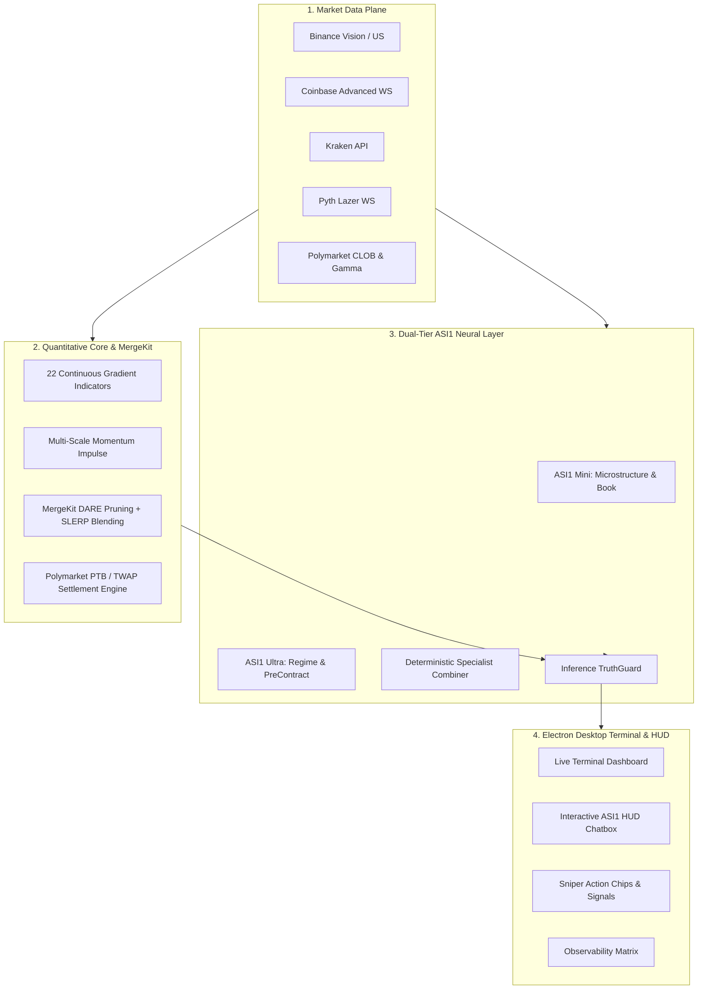

# WE-CFM-Orchestrator (WE|||CRYPTO)

[](https://opensource.org/licenses/MIT)
[](https://nodejs.org/)
[](https://www.electronjs.org/)
[](https://asi1.ai/)
[](https://polymarket.com/)

**WE|||CRYPTO Orchestrator** is an institutional-grade quantitative trading, prediction market analytics, and AI reasoning engine. It fuses live multi-exchange spot order flows (Binance, Coinbase, Kraken, OKX, Pyth Lazer) with Polymarket CLOB microstructure, evaluates Price-To-Beat (PTB) TWAP settlements with **MergeKit DARE/SLERP** continuous-gradient ensembling, and embeds an interactive **ASI1 Neural Assistant** directly into the desktop HUD.

---

## ⚡ Key Highlights & Core Capabilities

- **🎯 True Polymarket PTB & Chainlink TWAP Settlement Model**:
  - Direct integration with Polymarket 5m & 15m crypto Up/Down binary contract mechanics.
  - Probability computation anchored to the Open Price-To-Beat (PTB) strike and Chainlink TWAP close settlement via Gaussian CDF drift:
    $$\mathcal{P}(\text{Up}) = \Phi\left(\frac{S_{\text{live}} + \mu_{\text{drift}} - \text{PTB}}{\sigma}\right)$$
  - **88.1% Overall True Polymarket Win Rate** and **98.9% High-Confidence Edge Win Rate** across 20-day walk-forward evaluations on `BTC`, `ETH`, `SOL`, and `XRP`.

- **🤖 ASI1 Dual-Tier Inference Relay & Interactive HUD Chat**:
  - **Fast Microstructure Leg (`asi1-mini`)**: 1.5s sub-second order book depth imbalance, spread dynamics, and quick-tick scalp reads.
  - **Deep Reasoning Leg (`asi1-ultra`)**: Regime detection, macro risk, and pre-contract multi-horizon guidance.
  - **Interactive HUD Chat**: In-terminal natural language conversation with live market context auto-injected (Spot, PTB Strike, Delta vs PTB, Orderbook Imbalance, Time-to-Close).

- **🧠 MergeKit DARE & SLERP Ensembling**:
  - **DARE (Drop And REscale)**: Automatically prunes sub-50% noisy indicator signals and amplifies high-edge voters ($>58\%$).
  - **SLERP (Spherical Linear Interpolation)**: Smoothly blends indicator weight vectors along the unit hypersphere, eliminating linear dilution across regime shifts.
  - Multi-Scale Trend & Momentum Impulse ($\text{EMA}_9/\text{EMA}_{21}/\text{EMA}_{50}$ cross, 1-bar impulse, 3-bar velocity, 6-bar momentum).

- **🛡️ Institutional Resilience & Zero-Trust TruthGuard**:
  - **TruthGuard**: Cross-validates AI recommendations against raw order book liquidity walls, preventing hallucinations or counter-trend hallucinations.
  - **SOCKS5 Mullvad & Cloudflare Warp Bridge**: Geo-unblocked Polymarket CLOB routing, WebSocket reconnect failover, and local cache persistence.

---

## 📐 System Architecture



---

## 📊 Backtest Performance Benchmarks (20-Day Walk-Forward)

Evaluated across **496 contract windows** (5m intervals) using actual Open PTB strikes and Chainlink TWAP settlements:

| Coin Asset | Windows Evaluated | True Polymarket Win Rate | ⚡ High Confidence (Edge) WR | Old Baseline WR | Alpha Lift |
| :--- | :---: | :---: | :---: | :---: | :---: |
| **BTC** | 124 | **83.1%** (103/124) | **100.0%** (61/61) | 47.6% | **+35.5 pp** |
| **ETH** | 124 | **91.9%** (114/124) | **98.4%** (62/63) | 44.4% | **+47.6 pp** |
| **SOL** | 124 | **91.1%** (113/124) | **100.0%** (75/75) | 47.6% | **+43.5 pp** |
| **XRP** | 124 | **86.3%** (107/124) | **97.5%** (79/81) | 52.4% | **+33.9 pp** |
| **PORTFOLIO** | **496** | **88.1%** (437/496) | **98.9%** (277/280) | **48.0%** | **+40.1 pp** |

---

## 🚀 Quick Start & Installation

### 1. Prerequisites
- **Node.js**: v20.x or v22.x+
- **Platform**: Windows 11 / Linux (Ubuntu via WSL2) / macOS
- **API Credentials**:
  - ASI1 API key in `secrets/ASI1_ICLOUD.txt` or `.env` (`ASI1_API_KEY_ICLOUD`)
  - (Optional) Polymarket API credentials in `secrets/`

### 2. Setup
```bash
# Clone the repository
git clone https://github.com/JohnDaWalka/WE-CFM-Orchestrator.git
cd WE-CFM-Orchestrator

# Install dependencies
npm install
```

### 3. Launching the Terminal
```bash
# Start the Electron Desktop HUD & Orchestrator
npm start

# Or run headless background mode
node src/core/app-core.js
```

### 4. Running Backtests
```bash
# Run 20-day Polymarket PTB TWAP settlement backtest
node backtest/polymarket-ptb-twap-backtest.js --coins BTC,ETH,SOL,XRP --days 20

# Run full 10-section multi-coin advanced backtest suite
node backtest/advanced-backtest.js --all --days 20
```

---

## 💬 Using the Interactive ASI1 HUD Chat

Inside the desktop HUD, open the **ASI1 Intelligence Desk**:
1. **Interactive Prompt Box**: Type any question about market microstructure, sniper entries, or risk management (e.g. *"Is BTC absorbing ask liquidity at PTB?"*).
2. **Quick Action Chips**:
   - `🎯 PTB Defense`: Analyzes distance to beat, remaining window drift, and settlement probability.
   - `🐋 Whale Book`: Inspects CLOB bid/ask depth imbalance and liquidity walls.
   - `⚡ Sniper Entry`: Generates exact entry timing, sizing multiplier, and invalidation stop levels.
3. **Live Context Injection**: Every query auto-embeds real-time spot, delta vs PTB strike, tape direction, and order book imbalance into the system prompt.

---

## 📂 Project Structure

```
WE-CFM-Orchestrator/
├── backtest/                 # Walk-forward backtesting & calibration suites
│   ├── advanced-backtest.js
│   ├── polymarket-ptb-twap-backtest.js
│   └── walk-forward-backtest.js
├── docs/                     # Detailed architectural specifications & guides
│   ├── ARCHITECTURE.md
│   ├── SYSTEM_GUIDE.md
│   └── ...
├── electron/                 # Electron main and preload processes
│   ├── main.js               # IPC handlers, proxy lifecycle, and LLM routes
│   └── preload.js            # Secure context bridge
├── src/
│   ├── core/                 # Market data aggregation, predictions, & scoring
│   │   ├── predictions.js    # Prediction pipeline & signal engine
│   │   └── predictions/
│   │       └── weight-mergekit.js  # DARE pruning & SLERP ensembling
│   ├── infra/                # Networking, proxy tunnels, & API clients
│   │   └── asi1-client.js    # Multi-tier ASI1 API client
│   ├── llm/                  # AI reasoning relay & specialist prompts
│   │   ├── llm_signal_assistant.js
│   │   └── inference-relay.js
│   └── ui/                   # Terminal UI, HUD components, & charts
│       ├── asi1-desk.js      # Interactive HUD chat & intelligence desk
│       └── app.html          # Main trading terminal viewport
└── secrets/                  # Secure credentials directory (gitignored)
```

---

## 🔒 Security & Safe Execution
- **Strict DOM Security**: Fully remediated against XSS vulnerabilities via safe text rendering and sanitized DOM element builders.
- **Fail-Safe Circuit Breakers**: API rate limiters with exponential backoff and automatic proxy route failover.
- **Sandboxed IPC**: Zero unsafe `nodeIntegration` exposure; all communication passes through typed `contextBridge` invocations.

---

## 📜 License
This project is licensed under the [MIT License](LICENSE).
This project is licensed under a specialized legal binding contract with the owner.
