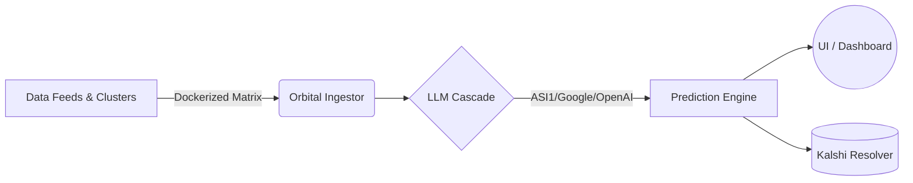

# WE-CFM-Orchestrator (WE CRYPTO)

An advanced, AI-powered predictive orchestration engine for cryptocurrency markets. WE-CRYPTO aggregates real-time data clusters via a robust Dockerized matrix, processes signals through a tiered LLM cascade (ASI1 ➡️ Google ➡️ OpenAI), and validates predictions against Kalshi and Polymarket prediction markets.

## Overview

The orchestrator is built to handle high-velocity data ingestion, complex local proxy routing, and rigorous walk-forward backtesting. To prevent this main page from becoming cluttered, the documentation is divided into focused, multi-paginated architectural deep dives.

<details>
<summary><strong>Quick Start Guide</strong></summary>

### Prerequisites

- Node.js (v18+)
- Docker & Docker Compose (for the Orbital Matrix and Redpanda)
- API Keys for ASI1, Google, OpenAI, and Coinbase

### Running the System

```bash
# 1. Start the Dockerized Data Clusters (Redpanda/Kafka, Ingestion)
docker-compose up -d

# 2. Install dependencies
npm install

# 3. Launch the Orchestrator
npm start
```
</details>

<details>
<summary><strong>High-Level Flow</strong></summary>



</details>

---

## Architecture & Component Deep Dives

To thoroughly understand the system, please explore the redirectable links below detailing each component's architecture, data flow, and specific containerization strategies.

### 1. [System Architecture & Data Clusters](./docs/ARCHITECTURE.md)

**Highlights:** Docker containerization, Redpanda Kafka data bus, Proxy Orchestrator, and Electron IPC bridging. Learn how the Orbital Matrix manages high-throughput data clusters.

### 2. [LLM Engine & Signal Processing](./docs/llm_engine.md)

**Highlights:** The ASI1 ➡️ Google ➡️ OpenAI fallback cascade, specialized prompt assembly, and inference routing.

### 3. [Kalshi Markets & Backtesting](./docs/kalshi_and_backtesting.md)

**Highlights:** Walk-forward tuning, historical contract cache discovery, and predictive accuracy scorecarding.

### 4. [Real-time Data Feeds](./docs/data_feeds.md)

**Highlights:** Coinbase Advanced Trade WebSockets, DEX activity monitors, and throttled fetch topologies.

---
*Built for extreme reliability and robust, resilient data ingestion.*
