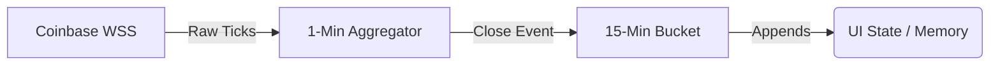

# Real-time Data Feeds

The system aggregates multiple independent data streams to build a comprehensive view of the crypto market.

## Coinbase Advanced Trade WebSocket

The `candle-ws.js` module connects directly to Coinbase's Advanced Trade WSS endpoints to build proprietary 1-minute and 15-minute candlesticks.

## Secondary Feeds
- **DEX Activity Monitor:** Tracks decentralized exchange volume spikes.
- **Mempool Telemetry:** Monitors pending block transactions to gauge sudden spikes in gas or block density, acting as a leading indicator for market volatility.
- **Throttled Fetching:** Utility modules (`throttled-fetch.js`) ensure REST API limits (like CoinGecko) are respected to prevent HTTP 429 and 503 errors.
