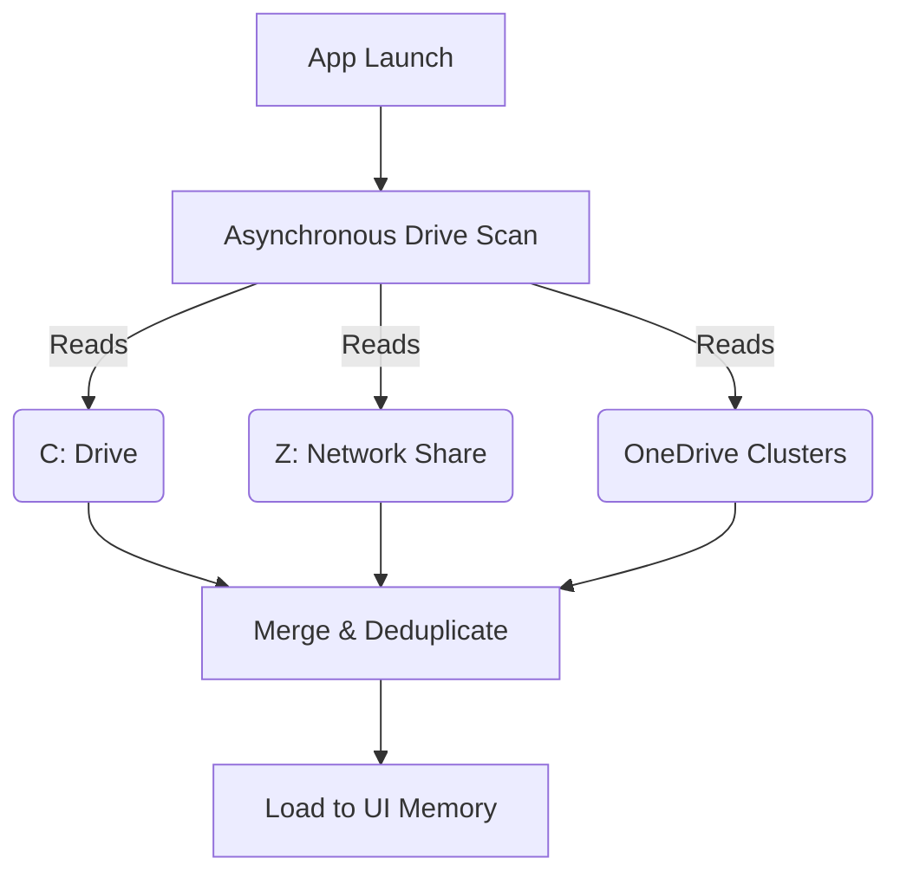

# Polymarket-Chainlink TWAP-settlement Markets & Backtesting

WE-CRYPTO validates its AI-generated signals by mapping them directly against regulated prediction markets like Polymarket.

## Contract Cache Discovery

To backtest models quickly, the system stores millions of historical Polymarket resolutions in a local drive cache.

*Note: The drive scan operates entirely asynchronously using `fs.promises` to ensure network timeouts (e.g., disconnected Z: drives) never freeze the UI.*

## Walk-Forward Tuning

The Adaptive Tuning Engine continuously refines model weights using a Walk-Forward backtest methodology.

- **Window Sizing:** Tests 400-candle windows with up to 250 iterations to prevent OOM (Out Of Memory) crashes.
- **Outcome Retuner:** Adjusts signal strength modifiers based on whether the previous Polymarket contract resolved `YES` or `NO`.
