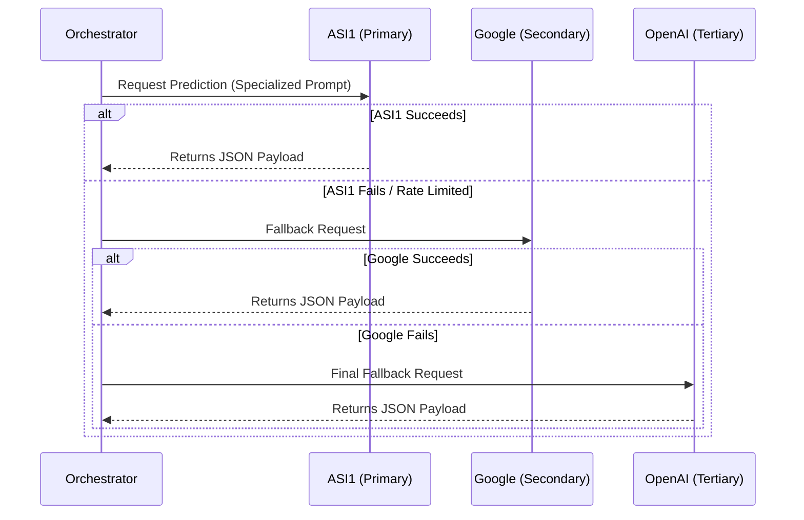

# LLM Engine & Signal Processing

The predictive heart of WE-CRYPTO relies on a robust LLM tier system. Since API reliability can fluctuate, the engine implements a rigorous fallback cascade.

## The Tiered Cascade

### Component Details

- **ASI1 First:** By user directive, the system always prioritizes the ASI1 inference layer (`llm_signal_assistant.js`).
- **Prompt Engineering (`specialized_prompt.js`):** The context window is injected with recent 15-minute Coinbase candle closures, funding rates, and mempool telemetry before being sent to the LLM.
- **Model Score:** The LLM returns a confidence score and a direction (`UP`, `DOWN`, `FLAT`). This payload is parsed and merged into the active UI state.
